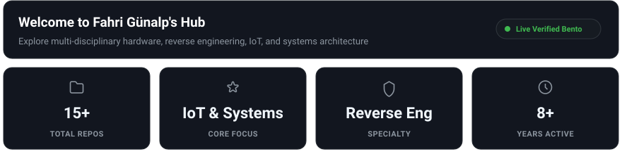
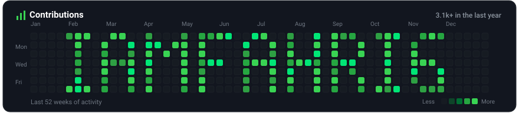
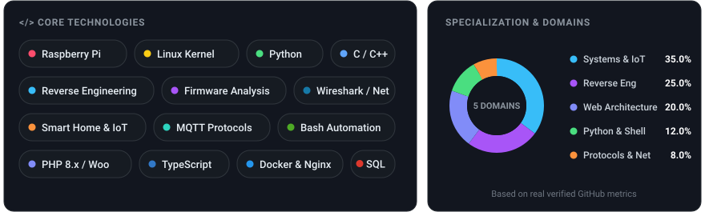

  <!-- 1. Hub & 4 KPI Cards (Spacious 216px) -->
  

   

  <!-- 2. 52-Week IAMFAHRIG Heatmap (192px) -->
  

   

  <!-- 3. Tech Stack & Balanced Donut (265px) -->
  

   

  <!-- Action Bar -->
  

    
    &nbsp;
    
    &nbsp;
    
  

